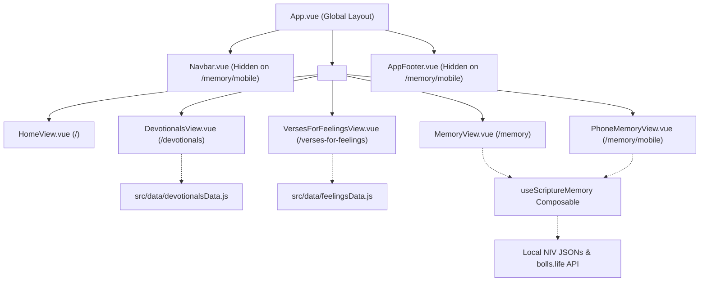

# Bible Station Application Specification (`spec.md`)

This document serves as the single source of truth for the architecture, design system, component hierarchy, functional requirements, routing, and deployment configuration for **Bible Station**.

---

## 1. Architecture Overview

Bible Station is a single-page application (SPA) built using **Vue 3** and **Vite**, with client-side routing managed by **Vue Router 4**.

### Key Technical Specs
- **Framework**: Vue 3 (Composition API / Single File Components `<script setup>`)
- **Build Tool**: Vite
- **Routing**: Vue Router 4 using HTML5 Web History (`createWebHistory(import.meta.env.BASE_URL)`). Clean direct URLs without hashtags (`/devotionals`, `/memory`, `/memory/mobile`, `/verses-for-feelings`), with `/phonememory` and `/phone-memory` redirecting to `/memory/mobile`, and `/memory` automatically redirecting mobile devices (by user agent or viewport ≤ 767px) to `/memory/mobile`.
- **GitHub Pages Fallback**: Single-Page Application redirect via `public/404.html` and `index.html` to support direct deep linking and page reloads on static GitHub Pages hosting.
- **Styling**: Vanilla CSS utilizing CSS Custom Properties (Design Tokens), zero heavy CSS frameworks. Google Fonts `Inter` and `Playfair Display` for typography.

---

## 2. Design System & Style Tokens

### 2.1 Color Palette ("Warm Sanctuary")
- `--bg-color: #f7f5f0` (Primary page background — warm cream)
- `--bg-subtle: #f2efe8` (Subtle background for alternating sections)
- `--text-main: #2c2c2c` (Primary body text — deep charcoal)
- `--text-light: #6b6560` (Secondary text, subtitles, meta — warm gray)
- `--accent-color: #3d6b6e` (Primary Warm Teal: headers, primary buttons, borders)
- `--secondary-color: #5a7a68` (Positive/Uplifting Warm Sage: positive emotion accents)
- `--disclaimer-bg: #f0ece4` (Callout container background — warm cream)
- `--card-bg: #ffffff` (Card background)
- `--border-color: #e8e4de` (Standard border — warm gray)
- `--success-color: #166534` / `--success-bg: #dcfce7` (Correct input feedback)
- `--error-color: #991b1b` / `--error-bg: #fee2e2` (Error input feedback)

### 2.2 Elevation & Shape Tokens
- `--shadow-xs` through `--shadow-xl`: Layered multi-stop box-shadows with warm-tinted `rgba(60, 50, 40, ...)` for subtle material depth
- `--shadow-glow: 0 4px 16px -2px rgba(61, 107, 110, 0.15)`: Warm teal glow for primary button hover
- `--radius-sm: 8px`, `--radius-md: 12px`, `--radius-lg: 16px`, `--radius-xl: 24px`, `--radius-full: 9999px` (pill)
- `--transition-fast: 0.15s`, `--transition-base: 0.2s`, `--transition-smooth: 0.3s` (all using `cubic-bezier(0.4, 0, 0.2, 1)`)

### 2.3 Typography
- **Heading & Display Font**: `'Playfair Display', Georgia, 'Times New Roman', serif` — aliased as `var(--heading-font)` (loaded via Google Fonts in `index.html`, weights 400/500/600/700, includes italic)
- **UI & Navigation Font**: `'Inter', -apple-system, BlinkMacSystemFont, "Segoe UI", Roboto, Helvetica, Arial, sans-serif` — aliased as `var(--body-font)` (loaded via Google Fonts in `index.html`, weights 400/500/600/700)
- **Scripture & Devotional Text Font**: `Georgia, 'Times New Roman', serif` — aliased as `var(--scripture-font)`
- **Decorative Elements**: Page titles include a centered decorative underline (40px × 2px accent-colored rule via `::after` pseudo-element).

### 2.4 Animations
- **Fade In**: `@keyframes fadeIn { from { opacity: 0; transform: translateY(6px); } to { opacity: 1; transform: translateY(0); } }` (0.35s, cubic-bezier)
- **Shake**: `@keyframes shake { 0%, 100% { transform: translateX(0); } 25% { transform: translateX(-4px); } 50% { transform: translateX(4px); } 75% { transform: translateX(-4px); } }`
- **Page Transitions**: Smooth 0.25s opacity + translateY fade with cubic-bezier easing

---

## 3. Global Navigation & Layout

### 3.1 Navigation Bar (`src/components/Navbar.vue`)
- Positioned persistently at the top of standard site views (hidden automatically on `/memory/mobile` to provide a dedicated standalone mobile web app experience).
- **Glass-morphism**: Semi-transparent warm-tinted background (`rgba(247, 245, 240, 0.85)`) with `backdrop-filter: blur(12px)` for frosted-glass effect.
- **Brand Logo**: Inline SVG open-bible icon (black outline, `--accent-color` stroke) next to the brand title.
- **Brand Title**: "Bible Station" in `Playfair Display` serif, linking to `/`.
- **Favicon**: `public/favicon.svg` — same open-bible SVG with a `#fcfcfc` rounded-rect background for dark-mode browser tab visibility.
- **Navigation Links**:
  1. `Home` (`/`)
  2. `Scripture Memory Tool` (`/memory`)
  3. `Bible Verses for Feelings` (`/verses-for-feelings`)
  4. `Devotionals` (`/devotionals`)
- **Mobile Route Linking**: No link to `/memory/mobile` exists in the global navigation bar; it is linked from the `/memory` page ("Using a mobile device? Switch to our mobile-friendly page!") and accessible by direct URL.
- **Active Route Highlighting**: Active link indicated with pill-shaped highlight (`--radius-full`), `--accent-color` text, and `--disclaimer-bg` background.
- **Mobile Responsiveness**: Clean mobile drawer/toggle for viewports under `768px` with glass-morphism backdrop.

### 3.2 Footer (`src/components/AppFooter.vue`)
- Positioned at the bottom of the page content on standard site views (hidden on `/memory/mobile`).
- Displays copyright notice: `© 2026 Bible Station. All Rights Reserved.`

---

## 4. Views & Route Specifications

### 4.1 Home View (`/` -> `src/views/HomeView.vue`)
- **Hero Header**:
  - Title: "Bible Station"
  - Subtitle: "Your daily stop for scripture, strength, and spiritual growth."
- **Welcome Section**:
  - Welcome greeting and site mission text.
- **Mission Feature Grid** (2-column responsive layout):
  - Card 1: **Memorize the Word** (description with button/link to `/memory`).
  - Card 2: **Find Encouragement** (description with links to `/verses-for-feelings` and `/devotionals`).
- **Hero Verse Banner**:
  - Featured verse: *"Your word is a lamp for my feet, a light on my path."* — Psalm 119:105 NIV.

### 4.2 Devotionals View (`/devotionals` -> `src/views/DevotionalsView.vue`)
- **Header**: Title "Devotionals".
- **Disclaimer Banner**: Explains that posts are for encouragement, passion for God's word.
- **Post List**: Dynamically rendered from `src/data/devotionalsData.js`.
- **Pagination** (10 posts per page):
  - Page state managed via `?page=N` query parameter (default: page 1).
  - Pagination controls rendered below posts: Previous arrow, numbered page buttons, Next arrow.
  - Active page highlighted with `--accent-color` background.
  - Browser back/forward navigation supported via `router.replace` and route query watcher.
- **Copy Link Button**:
  - Inline chain-link SVG icon to the right of each post title.
  - On click: copies URL `<base>/devotionals?post=<id>` to clipboard.
  - Shows brief "Copied!" tooltip (2-second fade animation).
  - Styled with `--text-light` default, `--accent-color` on hover.
- **Deep Linking** (`?post=<id>`):
  - On mount, checks for `post` query parameter.
  - Looks up the devotional's index in the full array and computes the correct page (`Math.floor(index / 10) + 1`).
  - Navigates to the computed page and scrolls the matching `<article>` element into view.
  - Applies a brief highlight flash animation (box-shadow pulse) on the target post.
  - Links remain stable even when new devotionals shift content across pages.
- **Post Schema**:
  - `id`: string (kebab-case slug, used for deep linking and DOM element id)
  - `title`: string
  - `author`: string
  - `date`: string
  - `verseQuote`: string
  - `verseCite`: string
  - `paragraphs`: string[]

### 4.3 Scripture Memorizer View (`/memory` -> `src/views/MemoryView.vue`)
- **Header**: Title "Scripture Memorizer" and subtitle.
- **Configuration Card**:
  - **Input Mode Segmented Selector**: Prominent top toggle allowing users to seamlessly switch between two dedicated source modes:
    - **Bible Translation** (default): For reference lookup with supported translations.
    - **Paste Custom Text**: For practicing with any custom translation, study notes, or passage not present in the catalog.
  - **Bible Translation Mode**:
    - Reference input: Text field supporting single verses (e.g. `John 3:16`), verse ranges (e.g. `Romans 8:28-30`), and full chapters (e.g. `1 John 1`, `Psalm 23`).
    - Searchable Translation dropdown (instant search by full name, abbreviation like 'NASB', or year; ordered from most to least common with NIV first and default):
      - `niv2011`: New International Version (NIV, default)
      - `kjv`: King James Version (KJV)
      - `esv`: English Standard Version (ESV)
      - `nlt`: New Living Translation (NLT)
      - `nkjv`: New King James Version (NKJV)
      - `csb`: Christian Standard Bible (CSB)
      - `nasb`: New American Standard Bible (NASB - 1995)
      - `niv1984`: New International Version (NIV - 1984)
      - `amp`: Amplified Bible (AMP)
      - `net`: New English Translation (NET)
      - `web`: World English Bible (WEB)
      - `asv`: American Standard Version (ASV)
      - `bbe`: Bible in Basic English (BBE)
    - Pinned Dropdown Footer: *"Can't find your translation? Paste custom text →"* button for direct access.
    - Dropdown Empty Search State: When a search returns no matching translations, offers a direct *"Paste custom text instead →"* action.
    - Contextual Helper Line: Helpful note underneath the dropdown (*"Can't find your translation? Paste custom text instead"*).
  - **Paste Custom Text Mode**:
    - Reference / Title input: Text field for passage title or reference (e.g. `John 3:16` or `Romans 8:28`).
    - Custom Scripture Textarea: Multi-line text field allowing immediate pasting of any text.
    - "Switch to Bible Translations" action to return to translation lookup anytime.
  - Load Verse button: Fetches verses or full chapters via client-side reference parsing, sourcing clean text (without verse numbers or section headings) from local NIV datasets (`public/data/translations/niv2011/` and `public/data/translations/niv1984/`) or direct scripture service (`bolls.life` for NASB 1995, ESV, KJV, etc.), or uses custom text, cleans whitespace/headings, and initializes the dashboard.
- **Interactive Game Dashboard** (6 Modes):
  - **Responsive Mode Navigation**:
    - **Desktop (> 768px)**: Horizontal tab pill bar (`.desktop-tabs`) with active state highlights.
    - **Mobile (≤ 768px)**: Dedicated custom-styled dropdown menu (`.mobile-tabs-dropdown`) featuring an accessible `<select>` with custom chevron and 16px font (preventing iOS auto-zoom), cleanly adapting to smartphone viewports.
  - **Mobile Virtual Keyboard Integration**:
    - "Type Full" and "Type First Letters" modes embed an invisible `<input>` (`.invisible-typing-input`) overlaid across the display box.
    - Tapping the display box, tapping the focus hint ("Click or tap here to start typing…"), or switching modes programmatically summons the mobile on-screen keyboard without browser security blocks.
    - Dual event handling: captures desktop physical keystrokes via `@keydown` and mobile virtual keystrokes via `@input` with deduplication protection.
    - Input automatically blurs on victory completion, gracefully dismissing the mobile keyboard so the celebration message is fully visible.
  1. **Vanish Mode**:
     - Toolbar buttons: `0%`, `25%`, `50%`, `75%`, `100%`.
     - Randomly blanks out selected % of words with underscores.
     - Clicking a hidden word reveals it interactively.
  2. **Fill in the Blanks Mode**:
     - Toolbar buttons: `25%`, `50%`, `75%`, `100%`.
     - Replaces selected words with inline text inputs.
     - "Check Answers" button: Compares sanitized strings (`cleanString`), turns correct words green, shakes and turns incorrect words red, displays status feedback message.
  3. **Word Choice Mode**:
     - Verse progress display showing solved words in green and pending word slots (`—` or `?` for the active slot); clicking any pending slot jumps to it.
     - For the active word slot, displays 5–7 grammatically matched option buttons generated via `generateWordOptions()` using fine-grained grammatical categories (pronoun case, verb tense/form, proper/singular/plural nouns, coordinating/subordinating conjunctions, adjectives, negation/general adverbs), preceding-word context disambiguation, punctuation/capitalization matching, and same-category words from the verse.
     - Selecting the correct word fills the slot and auto-advances to the next pending slot; selecting an incorrect word triggers red shake feedback.
     - Displays completion message ("Perfect! You chose every word correctly.") when all slots are solved.
     - "Reset Word Choice" button restarts the challenge.
  4. **First Letter Mode**:
     - Displays the first alphanumeric character of each word, replacing remaining characters with `_`.
     - Clicking/tapping a word toggles inline reveal of the full word (works on both desktop and mobile).
  5. **Type Full Mode**:
     - Inline typing directly in the verse display box (no separate textarea).
     - Keystrokes captured via native invisible input overlay supporting physical desktop keyboards (`@keydown`) and mobile virtual keyboards (`@input`).
     - Automatically skips spaces and punctuation in typing matching logic.
     - "Hide Verse (Type from Memory)" / "Show Verse to Learn" toggle.
     - Character styling: typed correct (bold green), typed incorrect (red background), upcoming chars (muted grey or hidden depending on mode), punctuation (slate).
     - **Error correction**: incorrect characters are shown in red; typing the correct letter replaces the wrong one in-place (no Backspace required, though Backspace is also supported).
     - Blinking cursor indicator (`|`) at the current typing position when the box is focused.
     - "Click or tap here to start typing…" overlay hint when the box is unfocused and no characters have been typed.
     - Full completion celebration message ("Perfect! You typed the verse perfectly.") when 100% typed correctly, auto-dismissing virtual keyboard.
  6. **Type First Letters Mode**:
     - Memory-only word-level first-letter typing challenge: user types only the first letter of each word.
     - Inline keystroke capture on the display box with physical and mobile virtual keyboard support.
     - Correct letter instantly reveals the full word in green and advances to the next word.
     - Incorrect letter flashes red (400ms) without revealing the correct letter; word resets to pending.
     - Blinking cursor and "Click or tap here to start typing…" focus hint (same pattern as Type Full).
     - "Show Next Word" hint button reveals the current word (styled in italic teal accent) and maintains mobile keyboard focus.
     - Full completion celebration message ("Perfect! You completed the verse!") when all words are completed, auto-dismissing virtual keyboard.

### 4.4 Verses for Feelings View (`/verses-for-feelings` -> `src/views/VersesForFeelingsView.vue`)
- **Header**: Title "Scripture for Every Season", subtitle.
- **Dynamic Verse Display Box**:
  - Displays selected verse text and citation.
  - Border and button accent adapts dynamically:
    - Uplifting/Positive feelings: `--secondary-color` (`#5c7a6b`).
    - Heavy/Negative feelings: `--accent-color` (`#4a6c6f`).
  - "Get Another Verse for '[Mood]'" button generates a new random verse from the active category.
  - Smoothly scrolls into view upon button click.
- **Emotion Categories**:
  - **Uplifting Feelings**:
    1. *Joy & Celebration*: Joyful, Excited, Victorious
    2. *Gratitude & Awe*: Thankful, Blessed, Amazed
    3. *Peace & Contentment*: Peaceful, Content, Safe
    4. *Love & Connection*: Loved, Loving, Forgiven
    5. *Hope & Inspiration*: Hopeful, Inspired, Confident
  - **Heavy Feelings**:
    6. *Fear & Uncertainty*: Anxious, Afraid, Doubtful
    7. *Sorrow & Grief*: Sad, Heartbroken, Grieving
    8. *Anger & Hurt*: Angry, Bitter, Betrayed
    9. *Weariness & Stress*: Tired, Overwhelmed, Stressed
    10. *Self-Worth & Isolation*: Lonely, Insecure, Guilty
- **Data Source**: `src/data/feelingsData.js` containing 30 emotion keys, each with at least 8 verified modern NIV (2011) scriptures.

### 4.5 Mobile Scripture Memorizer Web App (`/memory/mobile` -> `src/views/PhoneMemoryView.vue`)
- **Mobile Route & Redirects**: Accessible at `biblestation.org/memory/mobile` (or `/memory/mobile`), linked from the mobile callout banner on `/memory` ("Using a mobile device? Switch to our mobile-friendly page!"). Visiting `/memory` on a mobile device automatically redirects to `/memory/mobile`, and legacy `/phonememory` and `/phone-memory` routes redirect to `/memory/mobile`.
- **Standalone App Experience**:
  - Global `Navbar` and `AppFooter` are conditionally hidden (`v-if="!route.meta.isPhoneApp"`), dedicating 100% of the mobile viewport (`min-height: 100dvh`) to scripture memorization.
  - Safe-area insets (`env(safe-area-inset-top)` and `env(safe-area-inset-bottom)`) integrated into layout padding for edge-to-edge mobile devices.
- **Top Mobile App Bar**:
  - Sticky glass-morphism header (`rgba(247, 245, 240, 0.95)`, `backdrop-filter: blur(12px)`).
  - Bible Station brand icon alongside "Scripture Memory" title.
  - Interactive active-verse badge displaying current reference and translation pill (e.g. `John 3:16 · NIV`). Tapping opens the verse bottom sheet.
  - "Change" pill button (`.change-verse-btn`) providing immediate access to the verse picker.
- **Thumb-Friendly Horizontal Mode Switcher**:
  - Horizontally scrollable strip (`.mode-nav`) featuring 5 modes (`Vanish`, `Blanks`, `Word Choice`, `1st Letter`, `Type 1st`). ("Type Full" is intentionally omitted from the mobile view.)
  - Active pill highlighting in primary Warm Teal (`#3d6b6e`), full pill radius, and smooth tactile feedback.
- **Ergonomic Bottom Sheet Verse Drawer**:
  - Triggered by tapping "Change" or the verse reference tag.
  - Modal sheet animated from the screen bottom (`transform: translateY`) with backdrop blur and grab handle.
  - **Mode Toggle**: Seamlessly switch between "Bible Translation" (reference lookup + translation picker) and "Paste Custom Text" (title + custom textarea).
  - Automatically loads and closes on submission with inline validation banners.
- **Calibrated Phone Touch Practice Modes**:
  - Powered by shared composable `src/composables/useScriptureMemory.js`:
    1. **Vanish**: Large touch-friendly percentage pills (`0%`, `25%`, `50%`, `75%`, `100%`), 1.15rem Georgia serif typography, tap-to-reveal word interaction.
    2. **Fill in the Blanks**: Percentage selectors, 16px text input fields to prevent mobile browser auto-zoom, and instant "Check Answers" validation.
    3. **Word Choice**: Verse progress display with tappable slots, 5–7 plausible word option chips per slot with 44px+ touch targets and active scale states, error shake feedback, victory banner, and reset control.
    4. **First Letter**: Masked scripture hints with relaxed letter spacing, tap to toggle word peek.
    5. **Type First Letters**: Word-level first-letter challenge with "Show Next Word" hint button, error flash, and completion victory banner.
- **Local Storage Persistence**:
  - Automatically caches the user's active verse reference, translation, and mode into `localStorage` (`biblestation_phone_memory_v1`), allowing seamless resumption when re-opening the web app from a mobile home screen bookmark.

---

## 5. Branching, Governance & CI/CD Deployment

### 5.1 Branching Strategy & Main Protection
- **Rule of Branch Isolation**: Never commit or push directly to `main` without explicit user permission.
- **Feature Branches**: All feature additions, bug fixes, refactors, and document changes must be developed on dedicated branches using semantic naming:
  - `feat/<feature-name>`: New user-facing or technical features
  - `fix/<bug-name>`: Bug fixes and performance patches
  - `docs/<doc-topic>`: Specification, README, and governance updates
  - `chore/<task-name>`: Tooling, dependency, and configuration changes
- **Merge Approval**: Merging into `main` requires explicit user review and approval after local verification.

### 5.2 GitHub Actions Workflow (`.github/workflows/deploy.yml`)
- Triggered on:
  - `push` to branch `main`
  - `workflow_dispatch` (manual trigger)
- Configuration:
  - Runner: `ubuntu-latest`
  - Node version: `20`
  - Build command: `npm ci && npm run build`
  - Output directory: `dist`
  - Actions used:
    - `actions/checkout@v4`
    - `actions/setup-node@v4`
    - `actions/configure-pages@v5`
    - `actions/upload-pages-artifact@v3`
    - `actions/deploy-pages@v4`

### 5.3 Custom Domain & Clean Direct URL Routing (No Hash Routing)
- **Custom Domain**: `biblestation.org` — configured via `public/CNAME` which Vite copies into `dist/` on every build, ensuring the custom domain setting persists across GitHub Pages deployments.
- **Vite Base**: `base: '/'` — the site is served from the root of the custom domain.
- **History Mode**: `createWebHistory(import.meta.env.BASE_URL)`
- **SPA Fallback Script**:
  - `public/404.html` captures the current path and query string, redirecting to the index with query parameter `?/...`. Uses `pathSegmentsToKeep = 0` since the custom domain serves from root (no subpath).
  - `index.html` inspects `window.location.search`, replaces URL history state before Vue Router initializes, delivering clean URL paths without visible hashtags or page reloads.
